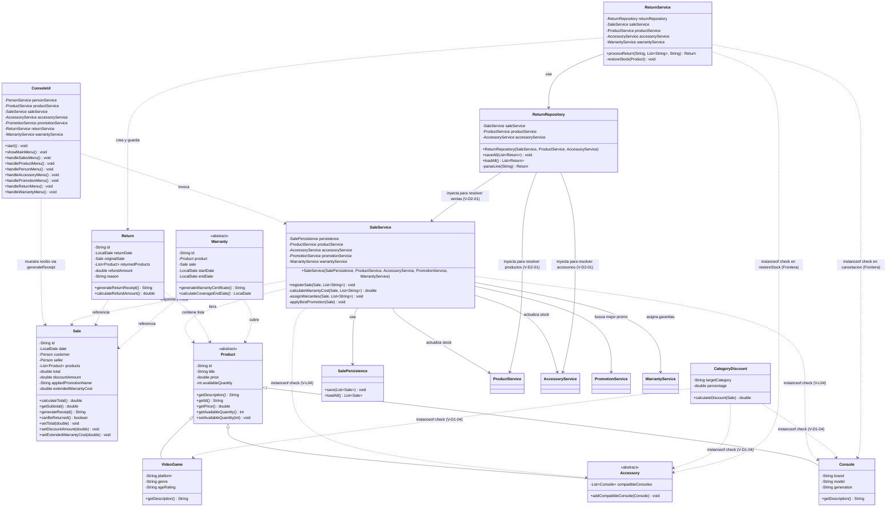

# Diagrama de Clases — Estado 'Antes' de la Refactorización GRASP

**Proyecto:** GameZone Unicesar  
**Fase:** Fase 2 — Corrección GRASP (Requerimiento 7)  
**Rama:** `feature/grasp-refactor`  
**Objetivo:** Modelar la estructura arquitectónica inicial previa a las correcciones, destacando los puntos de acoplamiento indebido, violaciones de polimorfismo, falta de cohesión y responsabilidades mal ubicadas identificadas durante la auditoría.

---

## 1. Diagrama de Clases Mermaid ('Antes')

---

## 2. Convenciones y Mapeo de Violaciones en el Diagrama

| Elemento en el Diagrama | Violación GRASP Identificada | Justificación Arquitectónica |
|---|---|---|
| `Sale.generateReceipt()` | **V-02 (V-L02) — High Cohesion** | La entidad de dominio `Sale` contiene lógica de formato textual y dibujo de tablas de consola, mezclando negocio con presentación. |
| `SaleService` $\rightarrow$ 5 Servicios + `Accessory` | **V-01 (V-L01) — Low Coupling** | Constructor sobrecargado con 5 dependencias e inspección directa de la subclase concreta `Accessory`. |
| `SaleService` (`instanceof Console`, `instanceof Accessory`) | **V-04 (V-L04) — Polymorphism** | Bifurcación manual de tipos para despachar stock y cobrar garantías extendidas en vez de invocar métodos polimórficos en `Product`. |
| `SaleService` mutando totales de `Sale` con setters | **V-05 (V-L05) — Information Expert** | El servicio asume la responsabilidad de calcular subtotales, garantías y descuentos, tratando a `Sale` como un contenedor anémico. |
| `ConsoleUI` centralizando 7 módulos | **V-03 (V-L03) — High Cohesion / God Controller** | Monolito de más de 1100 líneas con parsing de Scanner, validación y coordinación directa de todos los flujos. |
| `CategoryDiscount` (`instanceof` en cascada) | **V-08 / V-10 (V-D1-02, V-D1-04) — Low Coupling & Polymorphism** | Acoplamiento rígido hacia cada subclase de `Product`, violando el principio Open/Closed. |
| `ReturnRepository` inyectando 3 servicios de negocio | **V-12 (V-D2-01) — Low Coupling** | Inversión de capas donde una clase de persistencia CSV depende de servicios de alto nivel para hidratar referencias. |
| `Warranty` y `Return` con `generate*Certificate/Receipt()` | **V-09 (V-D1-03) — High Cohesion** | Entidades de dominio asumiendo responsabilidades de presentación de consola. |
| `Sale.canBeReturned()` usando `LocalDate.now()` | **V-07 (V-D1-01) — Information Expert** | La entidad `Sale` no tiene información de la fecha actual de evaluación; debe recibirla por parámetro. |
