# Integrated System — Class Diagram

This diagram presents the unified architecture of the GameZone Unicesar system, integrating all four business extensions (**Accessories**, **Promotions**, **Warranties**, and **Returns**) across the four architectural layers: **UI**, **Service**, **Persistence**, and **Model**.

```mermaid
classDiagram
    direction TB

    %% ==========================================
    %% UI LAYER
    %% ==========================================
    class ConsoleUI {
        -Scanner scanner
        -ProductService productService
        -PersonService personService
        -SaleService saleService
        -AccessoryService accessoryService
        -PromotionService promotionService
        -ReturnService returnService
        -WarrantyService warrantyService
        +start() void
        +showSaleMenu() void
        +showProductMenu() void
        +showPersonMenu() void
        +showAccessoryMenu() void
        +showPromotionMenu() void
        +showReturnMenu() void
        +showWarrantyMenu() void
    }

    %% ==========================================
    %% SERVICE LAYER
    %% ==========================================
    class SaleService {
        -SalePersistence persistence
        -ProductService productService
        -AccessoryService accessoryService
        -PromotionService promotionService
        -WarrantyService warrantyService
        +registerSale(Sale) void
        +registerSale(Sale, List~String~) void
        +listAllSales() List~Sale~
        +getSalesByCustomer(String) List~Sale~
        +getSalesBySeller(String) List~Sale~
    }

    class ProductService {
        -ProductPersistence persistence
        +registerVideoGame(VideoGame) void
        +registerConsole(Console) void
        +listAllProducts() List~Product~
        +updateStock(String, int) void
        +restoreStock(String, int) void
    }

    class AccessoryService {
        -AccessoryPersistence accessoryPersistence
        -List~Console~ availableConsoles
        -List~Accessory~ accessories
        +registerController(Controller) void
        +registerCable(Cable) void
        +registerMemory(Memory) void
        +listAllAccessories() List~Accessory~
        +listAccessoriesByType(String) List~Accessory~
        +findAccessoriesCompatibleWith(String) List~Accessory~
        +findById(String) Accessory
        +updateStock(String, int) void
        +restoreStock(String, int) void
    }

    class PromotionService {
        -PromotionRepository repository
        +registerPercentageDiscount(...) void
        +registerCategoryDiscount(...) void
        +registerBulkPurchaseDiscount(...) void
        +listAllPromotions() List~Promotion~
        +listActivePromotions() List~Promotion~
        +findBestPromotionFor(Sale) Promotion
    }

    class WarrantyService {
        -WarrantyRepository repository
        +assignBasicWarranty(Product, Sale, LocalDate) BasicWarranty
        +assignExtendedWarranty(Product, Sale, LocalDate) ExtendedWarranty
        +findWarrantyByProduct(String, String) Warranty
        +listAllWarranties() List~Warranty~
        +listActiveWarranties() List~Warranty~
        +listWarrantiesExpiringSoon(int) List~Warranty~
        +cancelWarranties(String, String) double
    }

    class ReturnService {
        -ReturnRepository repository
        -SaleService saleService
        -ProductService productService
        -AccessoryService accessoryService
        -WarrantyService warrantyService
        +registerReturn(String, List~String~, String) Return
        +viewAllReturns() List~Return~
        +viewReturnsByCustomer(String) List~Return~
        +viewReturnsBySale(String) List~Return~
        +calculateMonthlySales(int, int) double
        +calculateMonthlyReturns(int, int) double
        +generateMonthlyBalance(int, int) double
    }

    class PersonService {
        -PersonPersistence persistence
        +registerCustomer(Customer) void
        +registerSeller(Seller) void
        +listCustomers() List~Customer~
        +listSellers() List~Seller~
        +findCustomerById(String) Customer
        +findSellerById(String) Seller
    }

    %% ==========================================
    %% PERSISTENCE LAYER
    %% ==========================================
    class SalePersistence {
        <<data/sales.dat>>
        +save(List~Sale~) void
        +loadAll() List~Sale~
    }

    class ProductPersistence {
        <<data/products.dat>>
        +save(List~Product~) void
        +loadAll() List~Product~
    }

    class AccessoryPersistence {
        <<data/accessories.csv>>
        +saveAll(List~Accessory~) void
        +loadAll(List~Console~) List~Accessory~
    }

    class PromotionRepository {
        <<data/promotions.csv>>
        +saveAll(List~Promotion~) void
        +loadAll() List~Promotion~
    }

    class WarrantyRepository {
        <<data/warranties.csv>>
        -SalePersistence salePersistence
        -ProductService productService
        -AccessoryService accessoryService
        +saveAll(List~Warranty~) void
        +loadAll() List~Warranty~
    }

    class ReturnRepository {
        <<data/returns.csv>>
        -SaleService saleService
        -ProductService productService
        -AccessoryService accessoryService
        +saveAll(List~Return~) void
        +loadAll() List~Return~
    }

    class PersonPersistence {
        <<data/sellers.csv>>
        +save(List~Person~) void
        +loadAll() List~Person~
    }

    %% ==========================================
    %% MODEL LAYER
    %% ==========================================
    class Person {
        <<abstract>>
        -String id
        -String name
        -String phone
        +getId() String
        +getName() String
        +getPhone() String
        +getFullSummary()* String
    }

    class Customer {
        -String email
        +getEmail() String
        +getFullSummary() String
    }

    class Seller {
        -String employeeCode
        -String shift
        +getEmployeeCode() String
        +getShift() String
        +getFullSummary() String
    }

    class Product {
        <<abstract>>
        -String id
        -String title
        -double price
        -int availableQuantity
        +getId() String
        +getTitle() String
        +getPrice() double
        +getAvailableQuantity() int
        +setAvailableQuantity(int) void
        +getDescription()* String
    }

    class VideoGame {
        -String platform
        -String genre
        -String ageRating
        +getDescription() String
    }

    class Console {
        -String brand
        -String model
        -String generation
        +getDescription() String
    }

    class Accessory {
        <<abstract>>
        -List~Console~ compatibleConsoles
        +getCompatibleConsoles() List~Console~
        +isCompatibleWith(String) boolean
    }

    class Controller {
        -String connectionType
        +getDescription() String
    }

    class Cable {
        -double lengthMeters
        -String connectorType
        +getDescription() String
    }

    class Memory {
        -int capacityGb
        -String memoryType
        +getDescription() String
    }

    class Sale {
        -String id
        -LocalDate date
        -Customer customer
        -Seller seller
        -List~Product~ products
        -double total
        -String appliedPromotionName
        -double discountAmount
        -double extendedWarrantyCost
        +getSubtotal() double
        +calculateTotal() double
        +generateReceipt() String
        +canBeReturned() boolean
    }

    class Return {
        -String id
        -LocalDate date
        -Sale originalSale
        -List~Product~ returnedProducts
        -String reason
        -double refundAmount
        -double refundedWarrantyAmount
        +calculateRefundAmount() double
        +generateReturnReceipt() String
    }

    class Promotion {
        <<abstract>>
        -String id
        -String name
        -LocalDate startDate
        -LocalDate endDate
        +isActive(LocalDate) boolean
        +calculateDiscount(Sale)* double
    }

    class PercentageDiscount {
        -double percentage
        +calculateDiscount(Sale) double
    }

    class CategoryDiscount {
        -double percentage
        -String targetCategory
        +calculateDiscount(Sale) double
    }

    class BulkPurchaseDiscount {
        -int minimumQuantity
        -double percentage
        +calculateDiscount(Sale) double
    }

    class Warranty {
        <<abstract>>
        -String id
        -Product product
        -Sale sale
        -LocalDate startDate
        -LocalDate endDate
        +getDurationInMonths()* int
        +getWarrantyType()* String
        +getAdditionalCost()* double
        +isActive(LocalDate) boolean
        +generateWarrantyCertificate() String
    }

    class BasicWarranty {
        +getDurationInMonths() int
        +getWarrantyType() String
        +getAdditionalCost() double
    }

    class ExtendedWarranty {
        +getDurationInMonths() int
        +getWarrantyType() String
        +getAdditionalCost() double
    }

    %% ==========================================
    %% INHERITANCE HIERARCHIES
    %% ==========================================
    Person <|-- Customer
    Person <|-- Seller

    Product <|-- VideoGame
    Product <|-- Console
    Product <|-- Accessory

    Accessory <|-- Controller
    Accessory <|-- Cable
    Accessory <|-- Memory

    Promotion <|-- PercentageDiscount
    Promotion <|-- CategoryDiscount
    Promotion <|-- BulkPurchaseDiscount

    Warranty <|-- BasicWarranty
    Warranty <|-- ExtendedWarranty

    %% ==========================================
    %% MODEL ASSOCIATIONS
    %% ==========================================
    Sale "1" o-- "1..*" Product : contains
    Sale --> Customer : buyer
    Sale --> Seller : cashier
    Accessory "1" o-- "0..*" Console : compatible with

    Warranty --> Product : covers
    Warranty --> Sale : associated sale

    Return --> Sale : originalSale
    Return "1" o-- "1..*" Product : returnedProducts

    %% ==========================================
    %% ORCHESTRATION & LAYER CONNECTIONS
    %% ==========================================
    ConsoleUI --> SaleService : delegates
    ConsoleUI --> ProductService : delegates
    ConsoleUI --> AccessoryService : delegates
    ConsoleUI --> PromotionService : delegates
    ConsoleUI --> WarrantyService : delegates
    ConsoleUI --> ReturnService : delegates
    ConsoleUI --> PersonService : delegates

    SaleService --> ProductService : updates stock
    SaleService --> AccessoryService : updates stock
    SaleService --> PromotionService : applies discount
    SaleService --> WarrantyService : assigns warranties
    SaleService --> SalePersistence : saves sale

    ReturnService --> SaleService : queries sales
    ReturnService --> ProductService : restores stock
    ReturnService --> AccessoryService : restores stock
    ReturnService --> WarrantyService : cancels warranties
    ReturnService --> ReturnRepository : persists returns

    WarrantyService --> WarrantyRepository : repository
    PromotionService --> PromotionRepository : repository
    ProductService --> ProductPersistence : persistence
    AccessoryService --> AccessoryPersistence : persistence
    PersonService --> PersonPersistence : persistence

    WarrantyRepository --> SalePersistence : resolves sale
    WarrantyRepository --> ProductService : resolves product
    WarrantyRepository --> AccessoryService : resolves accessory
```

---

## Key Architecture Highlights

1. **Layered Isolation:**
   - The **UI Layer** (`ConsoleUI`) interacts solely with the **Service Layer** and never performs persistence I/O or domain arithmetic.
   - The **Model Layer** contains zero references to services, repositories, or console input/output.
2. **Sale Orchestration (`SaleService`):**
   - Coordinates `ProductService` (consoles, video games) and `AccessoryService` (controllers, cables, memories) without altering the unified `Product` abstraction.
   - Computes promotional discounts via `PromotionService.findBestPromotionFor` exclusively on the merchandise subtotal before adding extended warranty fees.
   - Persists the sale through `SalePersistence` before delegating warranty assignments to `WarrantyService`.
3. **Return Orchestration (`ReturnService`):**
   - Reverts the side-effects of purchases by restoring stock through both `ProductService` and `AccessoryService`.
   - Computes proportional refunds matching discounts applied by `PromotionService`.
   - Revokes active warranties and refunds extended coverage fees through `WarrantyService`.
4. **Leaf Repositories:**
   - `WarrantyRepository` resolves sales by consulting `SalePersistence` directly, breaking circular dependencies between `SaleService` and `WarrantyService`.
