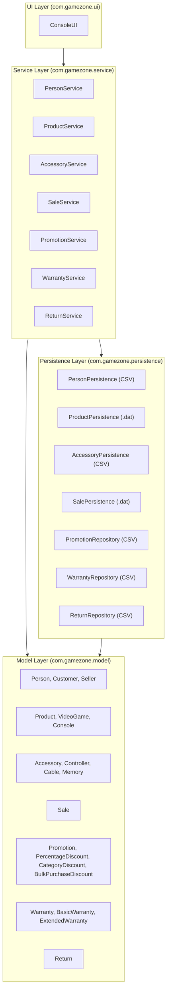

# Layers Diagram — GameZone Unicesar (Integrated System)

## Architectural Notes
- **Strict Layering:** Dependencies flow strictly downward: `UI → Service → Persistence → Model`.
- **Domain Purity:** The `Model` layer contains pure business entities with zero knowledge of file access, databases, or user interfaces.
- **Service Orchestration:** `SaleService` orchestrates items from both `ProductService` and `AccessoryService`, evaluates discounts via `PromotionService`, and delegates console coverage to `WarrantyService`.
- **Return Orchestration:** `ReturnService` validates 30-day return eligibility via `Sale.canBeReturned()`, restores stock through `ProductService` and `AccessoryService`, revokes warranties via `WarrantyService`, and calculates proportional refunds.
- **Persistence Decoupling:** `WarrantyRepository` resolves sales directly through `SalePersistence`, avoiding circular dependencies with `SaleService`.
