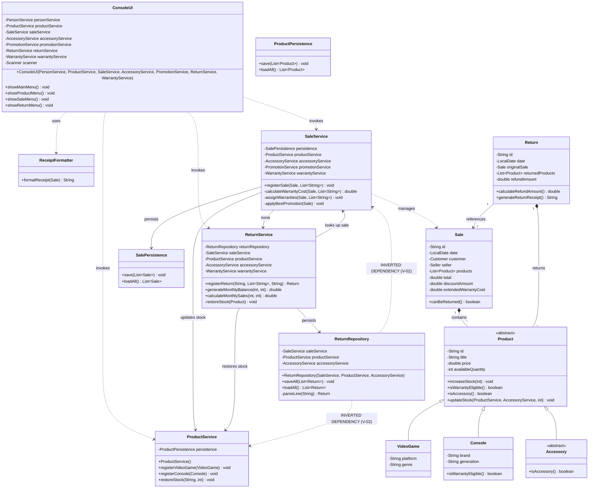

# Diagrama de Clases — Estado 'Antes' de la Refactorización SOLID

**Proyecto:** GameZone Unicesar  
**Fase:** Fase 2 — Corrección SOLID (Requerimiento 8)  
**Rama:** `feature/solid-refactor`  
**Objetivo:** Modelar la estructura arquitectónica del sistema antes de aplicar las correcciones SOLID, documentando visualmente las violaciones a SRP, OCP, LSP, ISP y DIP identificadas durante la auditoría.

---

## 1. Diagrama de Clases Mermaid ('Antes')

---

## 2. Catálogo de Violaciones Representadas en el Diagrama

| ID Violación | Principio SOLID | Elemento en el Diagrama | Descripción del Defecto de Diseño |
|---|---|---|---|
| **V-01** | Single Responsibility (SRP) | `SaleService` | Orquesta registro, cálculo de garantías, fallback de promociones, redondeo y salida directa a consola (`System.out.println`). |
| **V-02** | Dependency Inversion (DIP) | `ReturnRepository ..> SaleService` | Inversión de capas arquitectónicas: un repositorio de persistencia inyecta y llama servicios de lógica de negocio. |
| **V-03** | Dependency Inversion (DIP) | `ConsoleUI` | Acoplamiento rígido a 7 servicios concretos e instanciación directa no inyectable de `new Scanner(System.in)`. |
| **V-04** | Single Responsibility (SRP) | `Return.generateReturnReceipt()` | Construcción de texto de presentación con marcos decorativos dentro de la entidad de dominio `Return`. |
| **V-05** | Open/Closed (OCP) | `Product.updateStock(...)` | Firma que recibe servicios concretos (`ProductService`, `AccessoryService`), requiriendo modificación si surgen nuevos tipos de almacenamiento. |
| **V-06** | Open/Closed (OCP) | `ReturnService` | Evaluación con `instanceof Console` para cancelar garantías y `instanceof Accessory` para restaurar existencias. |
| **V-07** | Liskov Substitution (LSP) | `ProductService.restoreStock` | Mutación directa con `setAvailableQuantity` en lugar de llamar a `increaseStock`, ignorando invariantes de subtipos. |
| **V-08** | Single Responsibility (SRP) | `ReturnService` | Cálculo del total de ventas del mes (`calculateMonthlySales`), una responsabilidad contable ajena al módulo de devoluciones. |
| **V-09** | Dependency Inversion (DIP) | `ProductService` | Instanciación con `new ProductPersistence()` en el constructor, impidiendo mockeo o inyección de dependencias. |
| **V-10** | Open/Closed (OCP) | `ProductService` | Métodos separados `registerVideoGame` y `registerConsole` en lugar de un contrato extensible `registerProduct(Product)`. |
| **V-11** | Single Responsibility (SRP) | `Sale.canBeReturned()` | Regla de ventana de 30 días y reloj del sistema acoplados directamente dentro del registro inmutable de la venta. |
